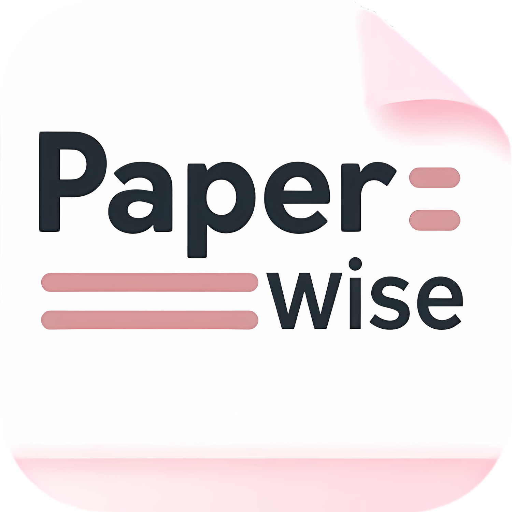

# PaperWise

PaperWise is a free, open-source Android app for turning photos and scans into PDFs. Pick images from your gallery or scan them with your camera, arrange and adjust the pages, then save the finished PDF on your device.



## Download

Choose a source below. GitHub Releases is the project's release page; the other links go to third-party app listings and may publish updates on a different schedule.

<table>
  <tr>
    <td align="center" width="50%"><a href="https://github.com/prateek54353/PaperWise/releases/latest"><strong>GitHub Releases</strong></a><br>Official APK releases</td>
    <td align="center" width="50%"><a href="https://www.openapk.net/paperwise/org.paperwise.app/"><strong>OpenAPK</strong></a><br>Open-source app listing</td>
  </tr>
  <tr>
    <td align="center" width="50%"><a href="https://www.androidfreeware.net/get-paperwise-apk.html"><strong>AndroidFreeware</strong></a><br>Third-party APK listing</td>
    <td align="center" width="50%"><a href="https://apt.izzysoft.de/fdroid/index/apk/org.paperwise.app/"><strong>IzzyOnDroid</strong></a><br>F-Droid-compatible repository listing</td>
  </tr>
</table>

## What it can do

- Create PDFs from multiple gallery images or camera scans.
- Reorder, crop, rotate, filter, or remove pages before creating the PDF.
- Choose a page size or fit each page to its image, and adjust output quality.
- Browse, search, sort, rename, share, and view saved PDFs.
- Split a PDF into smaller files or merge PDFs.
- Pick a light, dark, or AMOLED theme.

PDFs are stored locally on your device. PaperWise is ad-free.

## Build from source

The project uses Flutter. The repository's `.fvmrc` pins Flutter 3.22.2; install that version with [FVM](https://fvm.app/) or use a compatible Flutter SDK.

```sh
git clone https://github.com/prateek54353/PaperWise.git
cd PaperWise
fvm install
fvm flutter pub get
fvm flutter run
```

To build release APKs for Android:

```sh
fvm flutter build apk --release --split-per-abi
```

## License

PaperWise is released under the [MIT License](LICENSE).
